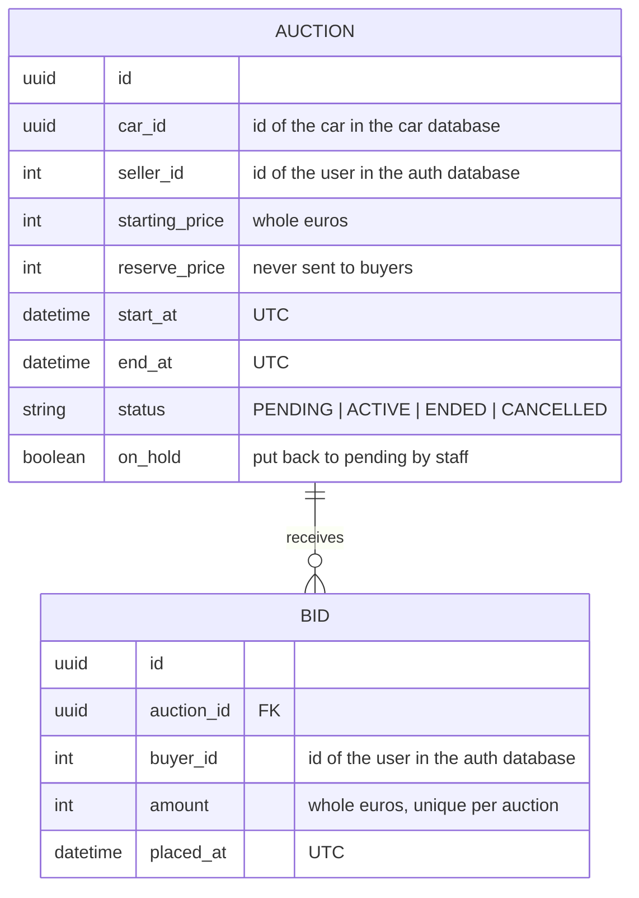

# Auction Service

REST API for auctions and bids of the VeloVault platform. Runs on port **4002** behind the API gateway, with its own SQLite database (see `products/erd.md` and `products/component-diagram.md`).

Built with the same setup as `car-service`: Express, TypeScript (native ESM), Prisma 7 with SQLite and Zod.

---

## Quick Start

```bash
cp .env.example .env
npm install            # also generates the Prisma client
npm run prisma:migrate
npm run prisma:seed    # needs the seeds of auth-service and car-service for the ids to match
npm run dev
```

The API is then available at `http://localhost:4002`. Normally you call it through the gateway at `http://localhost:3000/auctions`.

---

## Domain Model



---

## Project Structure

```text
src/
├── server.ts               # Middleware, routes, error handler, starts the scheduler
├── lib/
│   ├── prisma.ts           # Shared Prisma client (SQLite adapter)
│   └── time.ts             # Dutch date/time and euro formatting for messages
├── middleware/
│   ├── currentUser.ts      # Reads the user from the gateway headers + requireRole()
│   ├── errorHandling.ts    # HttpError, asyncHandler wrapper + central error handler
│   └── requestLogger.ts    # Logs method, path, status and time
├── routes/
│   └── auctions.ts         # /auctions
├── services/
│   ├── AuctionService.ts   # Auction rules and what each user may see
│   └── scheduler.ts        # Starts and ends auctions at their times
├── types/
│   └── index.ts            # Statuses
└── validation/
    └── schemas.ts          # Zod schemas for the request bodies and queries
```

---

## API Reference

Who the user is comes from the `X-User-Id` and `X-User-Role` headers that the API gateway adds after checking the token. Without them a write route answers `401`, with the wrong role `403`. The full spec is in `products/api-spec/auction-service.yaml`.

| Method | Path | Who | Description |
| --- | --- | --- | --- |
| GET | `/auctions` | everyone | List auctions, filter with `?status=` and `?carId=` |
| GET | `/auctions/:id` | everyone | One auction with current bid and number of bids |
| POST | `/auctions` | seller | Create an auction for your own car, starts as `PENDING` |
| PATCH | `/auctions/:id` | own seller, staff | Change prices or times while `PENDING` |
| DELETE | `/auctions/:id` | own seller, staff | Delete a `PENDING` auction without bids |

`reservePrice` and `reserveReached` are only in the answer for the seller of that auction and for staff (AUC-04, AUC-08).

**`GET /auctions/:id` response (as the seller):**

```json
{
  "data": {
    "id": "a1111111-1111-4111-8111-111111111111",
    "carId": "11111111-1111-4111-8111-111111111111",
    "sellerId": 3,
    "status": "ACTIVE",
    "startingPrice": 15000,
    "currentBid": 18000,
    "bidCount": 7,
    "startAt": "2026-10-21T00:21:00.000Z",
    "endAt": "2026-10-24T03:21:00.000Z",
    "createdAt": "2026-10-24T00:21:00.000Z",
    "updatedAt": "2026-10-24T00:21:00.000Z",
    "reservePrice": 20000,
    "reserveReached": false
  }
}
```

Errors look like `{ "error": { "code": "AUCTION_NOT_FOUND", "message": "We can't find this auction." } }`. The message can be shown to the user directly.

---

## Scheduler

`src/services/scheduler.ts` runs every `SCHEDULER_INTERVAL_MS` (default 5 seconds) and moves auctions on by itself (AUC-06):

| From | To | When |
| --- | --- | --- |
| `PENDING` | `ACTIVE` | the start time has passed and the auction is not on hold |
| `ACTIVE` | `ENDED` | the end time has passed |
| `PENDING` | `CANCELLED` | the end time has passed without the auction ever starting |

It uses `updateMany` with the old status in the `where`, so running it twice never changes an auction twice (NFR-11).

---

## Sample Data

The seed makes 6 auctions for the 6 seeded cars, with times relative to now: one that ends in 3 hours, two more that are active, two that haven't started and one that ended a week ago with 15 bids.

---

## Environment Variables

| Variable | Description | Default |
| --- | --- | --- |
| `DATABASE_URL` | SQLite file | `file:./data/database.sqlite` |
| `PORT` | Port | `4002` |
| `CAR_SERVICE_URL` | Car service, asked when an auction is created | `http://localhost:4000` |
| `SCHEDULER_INTERVAL_MS` | How often the scheduler runs | `5000` |

---

## Available Scripts

```bash
npm run dev           # Start with hot reload
npm run build         # Compile to dist/
npm run start         # Run the compiled build
npm run type-check    # TypeScript check without building
npm run prisma:migrate
npm run prisma:seed
npm run test:api      # Smoke test (car-service must run; start this service with SCHEDULER_INTERVAL_MS=1000)
```
