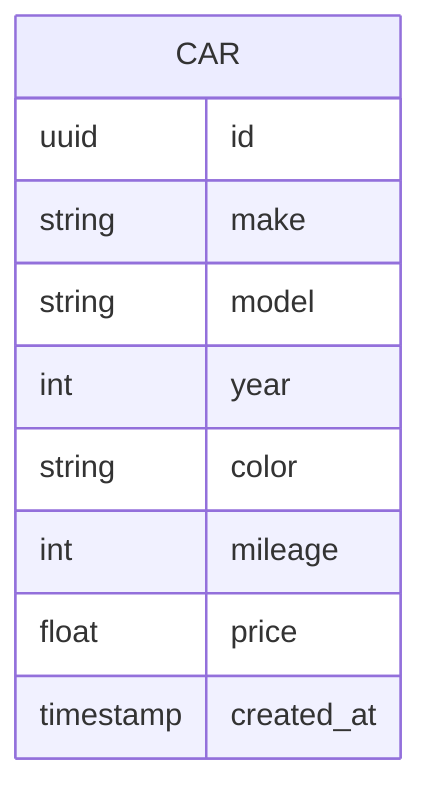
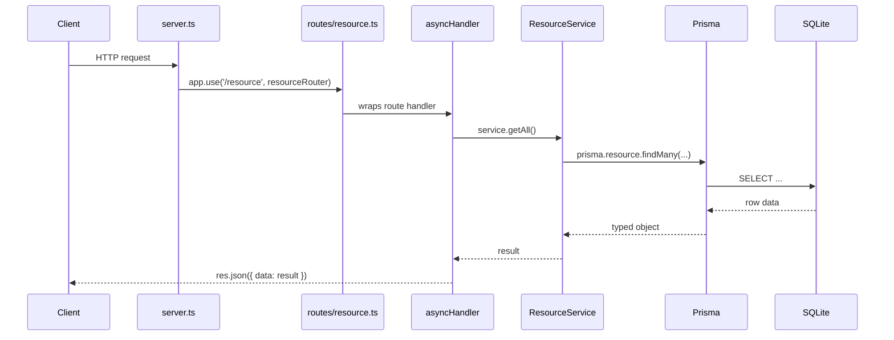
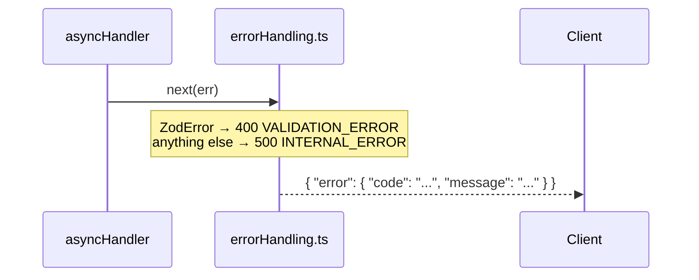

# Car Service

A minimal REST API for listing cars. Built on Node.js, Express, Prisma 7, and TypeScript with a SQLite database.

> Part of the car-auction-starter. Clients reach this service through the [api-gateway-service](../api-gateway-service), which proxies `/cars` here. The service is self-contained and also runs on its own.

## Quick Start

### Prerequisites

- Node.js 24
- npm

### Installation

```bash
# Create your local environment file
cp .env.example .env

# Installs dependencies and generates the Prisma client (postinstall)
npm install

# Create the database and run migrations
npm run prisma:migrate

# Seed with sample data
npm run prisma:seed

npm run dev
```

The API will be available at `http://localhost:4000`.

### Build for Production

```bash
npm run build
npm start
```

### Docker

`.env` is not baked into the image (it is listed in `.dockerignore`), so all environment variables must be passed in at `docker run` time. The final image only contains the compiled `dist/`, the generated Prisma client (for the seed script), production `node_modules` (plus the `prisma` and `tsx` CLIs), `prisma/`, `prisma.config.ts`, and `entrypoint.sh`. The image pre-creates `/data` for a mounted SQLite file:

```bash
docker build -t car-service .
docker run -p 4000:4000 \
  -e DATABASE_URL=file:/data/database.sqlite \
  -e SEED_DATABASE=true \
  -v $(pwd)/data:/data \
  car-service
```

`entrypoint.sh` runs `prisma migrate deploy` before starting the compiled server, so migrations apply automatically on container start. With `SEED_DATABASE=true` it also runs the seed script, which **replaces all cars** with the sample data on every start — leave it unset to keep your data.

---

## Domain Model



---

## Project Structure

```text
src/
├── server.ts              # App setup: middleware, route mounting, error handler
├── generated/
│   └── prisma/            # Generated Prisma client (git-ignored, do not edit)
├── lib/
│   └── prisma.ts          # Shared Prisma client (SQLite adapter)
├── middleware/
│   ├── errorHandling.ts   # asyncHandler wrapper + central error handler
│   └── requestLogger.ts   # Request logging middleware
├── routes/
│   └── cars.ts            # GET /cars
├── services/
│   ├── CarService.ts
│   └── index.ts
└── types/
    └── index.ts           # TypeScript interfaces

prisma/
├── schema.prisma          # Prisma data model (Car)
├── seed.ts                # Database seed script
└── migrations/

data/                      # Local SQLite database (git-ignored, only .gitkeep is committed)

prisma.config.ts           # Prisma 7 configuration
tsconfig.json              # TypeScript config (ESM, NodeNext, src/ → dist/)
.env.example               # Template for your local .env
.gitignore / .dockerignore # Keep .env, data, dist and src/generated out of git and the image
Dockerfile                 # Multi-stage Debian-slim build for the production image
entrypoint.sh              # Runs pending migrations (and optionally the seed), then starts the server
test-api.js                # API smoke test (npm run test:api)
```

The Prisma client is generated into `src/generated/prisma` (configured via `output` in `schema.prisma`). It is recreated on every `npm install` and is not committed, so run `npm run prisma:generate` after changing the schema.

---

## API Reference

Base URL: `http://localhost:4000`

All successful responses follow the OAS-aligned envelope format:

```json
{ "data": { ... } }
```

List responses include a `meta` object:

```json
{ "data": [...], "meta": { "count": 3 } }
```

### Cars

| Method | Path | Description |
| --- | --- | --- |
| GET | `/cars` | List all cars |

**`GET /cars` response:**

```json
{
  "data": [
    {
      "id": "550e8400-e29b-41d4-a716-446655440000",
      "make": "Volkswagen",
      "model": "Golf",
      "year": 2019,
      "color": "Blue",
      "mileage": 42000,
      "price": 16500,
      "createdAt": "2026-07-09T00:00:00.000Z"
    }
  ],
  "meta": { "count": 5 }
}
```

### Health

```http
GET /health
→ { "status": "ok", "service": "car-service", "environment": "development" }
```

---

## Error Responses

All errors return a structured `error` object:

```json
{
  "error": {
    "code": "NOT_FOUND",
    "message": "..."
  }
}
```

| Status | Code | Meaning |
| --- | --- | --- |
| 404 | `NOT_FOUND` | Resource does not exist |
| 400 | `VALIDATION_ERROR` | Request body failed Zod validation |
| 500 | `INTERNAL_ERROR` | Server or database error |

---

## Adding a New Route

Every route follows the same three-file pattern: service → router → mount.

### Request flow



### Error flow

When anything throws, `asyncHandler` forwards it to the central error handler — no per-route try/catch needed.



This service uses native ESM, so relative imports end in `.js` (TypeScript resolves `./CarService.js` to `CarService.ts`).

### Example: `CarService` + `cars` route

**1. The service** at `src/services/CarService.ts`:

```ts
import { prisma } from '../lib/prisma.js';

export class CarService {
  async getAll() {
    return prisma.car.findMany();
  }
}

export const carService = new CarService();
```

Exported from `src/services/index.ts`:

```ts
export { carService } from './CarService.js';
```

**2. The route** at `src/routes/cars.ts`:

```ts
import { Router } from 'express';
import { carService } from '../services/index.js';
import { asyncHandler } from '../middleware/errorHandling.js';

export const carsRouter = Router();

carsRouter.get('/', asyncHandler(async (req, res) => {
  const cars = await carService.getAll();
  res.json({ data: cars, meta: { count: cars.length } });
}));
```

**3. Mounted** in `src/server.ts`:

```ts
import { carsRouter } from './routes/cars.js';

app.use('/cars', carsRouter);
```

---

## Available Scripts

```bash
npm run dev              # Start dev server with hot reload (tsx watch)
npm run build            # Compile TypeScript
npm start                # Run compiled build

npm run prisma:migrate   # Run database migrations
npm run prisma:seed      # Seed sample data
npm run prisma:generate  # Regenerate Prisma client after schema changes
npm run prisma:studio    # Open Prisma Studio GUI
npm run type-check       # TypeScript check without building
npm run test:api         # Smoke-test the API against a running server
```

---

## Environment Variables

Copy `.env.example` to `.env` and adjust as needed. `.env` is git-ignored; never commit real secrets.

```env
# Database
DATABASE_URL="file:./data/database.sqlite"

# Server
PORT=4000
NODE_ENV=development
```

In Docker, `SEED_DATABASE=true` additionally seeds the database on start (see [Docker](#docker)).

---

## Dependencies

### Production

- **express** — web framework
- **@prisma/client** (v7) — database ORM
- **@prisma/adapter-better-sqlite3** — SQLite driver for Prisma 7
- **better-sqlite3** — SQLite native driver
- **zod** — runtime validation
- **cors** — CORS middleware
- **dotenv** — environment variable loading

### Development

- **prisma** (v7) — CLI for migrations and codegen
- **typescript** — TypeScript compiler
- **tsx** — TypeScript/ESM runner with watch mode, used for `npm run dev` and the seed script

This service uses native ESM (`"type": "module"` + `moduleResolution: NodeNext`), like every service in the car-auction-starter.

---

## Sample Data

The seed script populates 5 sample cars (Volkswagen Golf, Toyota Corolla, BMW 3 Series, Ford Focus, Tesla Model 3).

---

## Security Notes

- Prisma uses parameterized queries (SQL injection safe)
- CORS enabled — restrict origins before deploying to production

---

## License

MIT
