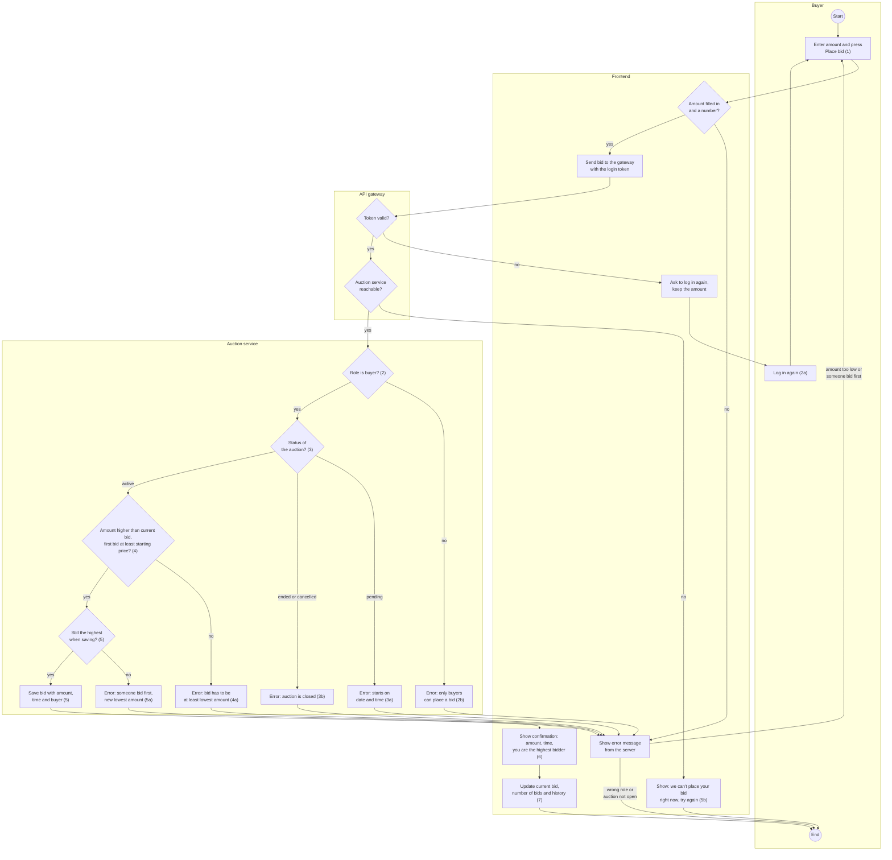

# Activity diagram: Place bid

Activity diagram for [use case 1: Place bid](use-case-place-bid.md). It has 4 swimlanes: the buyer, the frontend in the browser, the API gateway and the auction service. The numbers like (3a) are the step numbers from the use case.

## How to read it

- **Every check that matters is in the auction service** (2, 3, 4, 5). The frontend only checks if something is filled in, so Tom gets a quick message. The real rules are on the server (ACC-05), so nobody can get around them by changing the page.
- **The gateway checks the token first.** If it is expired, the buyer logs in again and the amount stays (2a). The auction service never gets a request without a valid login.
- **"Still the highest when saving?" (5a)** is checked at the moment the bid is saved. Two buyers can press at the same time in the last minute. Only the first one is saved (BID-07).
- **Two kinds of errors go back to different places.** A bid that is too low or too late goes back to the form, so Tom can bid again right away. A wrong role or a closed auction ends the use case.
- **If the auction service is down** the gateway answers with an error and the frontend shows a normal message, not a blank page (5b, NFR-10).
