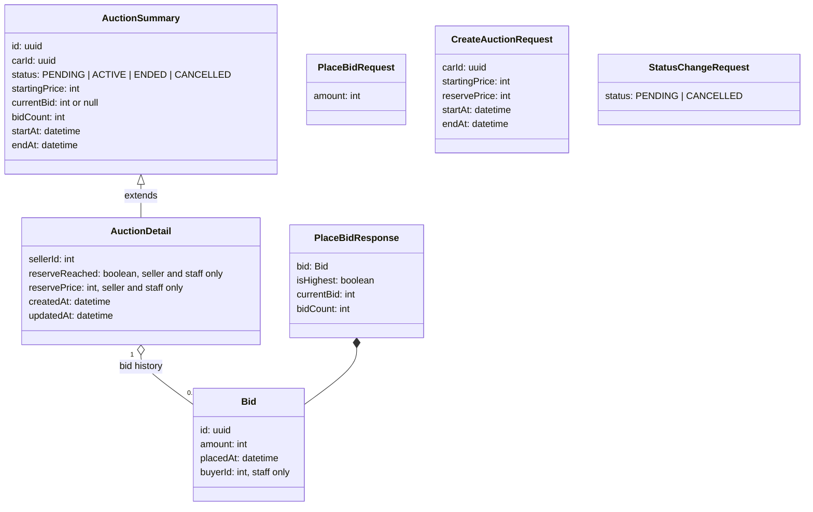
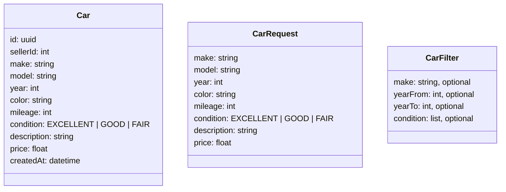
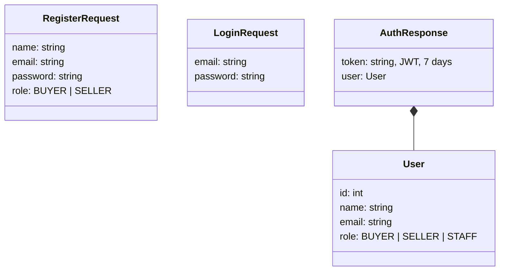

# API message design

The logical data objects (LDOs) of the messages between the frontend, the gateway and the services. An LDO describes what is in a message and the types, without saying how it is stored. The storage is in the [ERD](erd.md). The endpoints are in the [API specification](api-specification.md).

All messages are JSON. All times are ISO 8601 in UTC, the frontend shows them in Dutch time (NFR-15). All amounts are whole euros.

## General shape

Every service answers in the same way.

**Success**

```json
{
  "data": { },
  "meta": { "count": 0 }
}
```

`meta` is only there for lists.

**Error**

```json
{
  "error": {
    "code": "BID_TOO_LOW",
    "message": "Your bid has to be at least € 18.500.",
    "details": { "lowestAllowed": 18500 }
  }
}
```

- `code` is for the frontend, so it knows what to do (for example go back to the form).
- `message` is normal language and can be shown to the user directly (NFR-03).
- `details` is only there when it helps, for example the lowest allowed bid.

## Logical data object trees

### Auction service



### Car service



### Auth service



## Example messages for my 2 requirements

### BID-01: place a bid

`POST /auctions/{id}/bids` with the login token in the header.

Request:

```json
{ "amount": 18500 }
```

Response `201 Created`:

```json
{
  "data": {
    "bid": {
      "id": "7d1c3a52-5a1e-4a36-9c6b-0f0a4b7f2e11",
      "amount": 18500,
      "placedAt": "2026-10-16T18:42:07Z"
    },
    "isHighest": true,
    "currentBid": 18500,
    "bidCount": 9
  }
}
```

The frontend shows: "€ 18.500 at 20:42, you are now the highest bidder." (BID-04, time in Dutch summer time)

### STF-03: change the status

`PATCH /auctions/{id}/status` with the login token of a staff member.

Request:

```json
{ "status": "CANCELLED" }
```

Response `200 OK`: the whole `AuctionDetail` with the new status.

## Error codes

These come from the exception paths of the [use cases](use-case-place-bid.md).

| Code | HTTP | Message (shown to the user) | Use case path |
|---|---|---|---|
| `VALIDATION_ERROR` | 400 | "Fill in an amount in whole euros." | Bid 4a |
| `UNAUTHORIZED` | 401 | "Your login has expired. Please log in again." | Bid 2a, Status 7a |
| `FORBIDDEN_ROLE` | 403 | "Only buyers can place a bid." / "Only staff can change the status of an auction." | Bid 2b, Status 7b |
| `AUCTION_NOT_FOUND` | 404 | "We can't find this auction." | |
| `AUCTION_NOT_STARTED` | 409 | "This auction starts on [date time], you can bid from then." | Bid 3a |
| `AUCTION_CLOSED` | 409 | "This auction is closed, you can't bid anymore." | Bid 3b |
| `BID_TOO_LOW` | 409 | "Your bid has to be at least € [amount]." + `details.lowestAllowed` | Bid 4a, 5a |
| `STATUS_CHANGE_NOT_ALLOWED` | 409 | "This auction is [status] now, so it can't be changed to [new status]." | Status 8a |
| `STATUS_UNCHANGED` | 409 | "This auction is already [status]." | Status 8b |
| `SERVICE_UNAVAILABLE` | 502 | "We can't do this right now. Please try again in a moment." (made by the gateway) | Bid 5b, Status 9a |

**Why 409 for a closed auction or a too low bid:** the request itself is fine (it is a number), but it conflicts with the current state of the auction. 400 is only for a request that is wrong on its own.

## What is never in a message

- `reservePrice` is never sent to a buyer (AUC-04). Only the seller of that auction and staff get it.
- `buyerId` in the bid history is only sent to staff (BID-05, STF-07).
- `passwordHash` never leaves the auth service (NFR-12).
