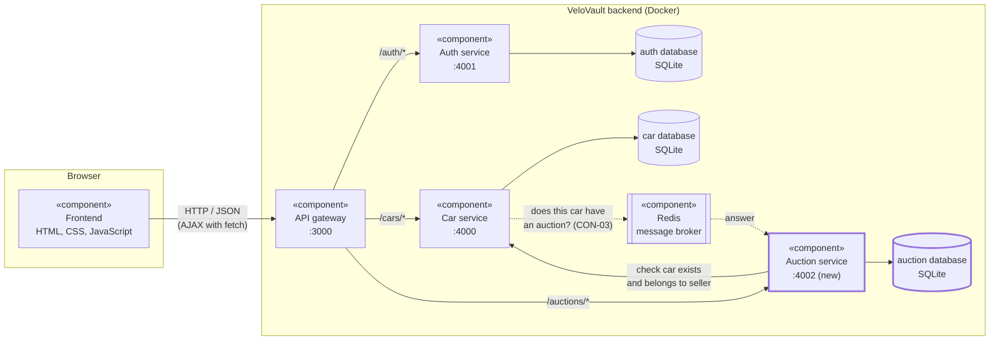

# Component diagram

UML component diagram of the microservice architecture of VeloVault. The auth service, car service and gateway are from the first version. The auction service is new in this sprint.

Solid arrows are HTTP calls, dashed arrows go through the message broker. The thick border is what I add in this sprint.

## Components

| Component | Job | Offers (interface) | Uses |
|---|---|---|---|
| Frontend | Pages for buyers, sellers and staff in the browser | Web pages | API gateway over HTTP/JSON |
| API gateway | Only entry point for the frontend. Checks the login token and sends the request to the right service. Adds the user id and role in headers. | `/auth/*`, `/cars/*`, `/auctions/*` on port 3000 | Auth, car and auction service |
| Auth service | Register, log in, make the JWT token | `POST /auth/register`, `POST /auth/login`, `GET /auth/me` | auth database |
| Car service | Cars CRUD | `/cars` | car database, Redis |
| Auction service (new) | Auctions and bids CRUD, the bid rules and the status rules | `/auctions`, `/auctions/:id/bids`, `/auctions/:id/status` | auction database, car service, Redis |
| Databases | Each service has its own SQLite file, no service reads the database of another | | |
| Redis | Message broker for the check before a car is deleted | Queue | |

## Why it is built like this

- **Every service has its own database** (CON-01). That is the distributed database: the auction service only stores the `car_id`, it never reads the car table. See the [ERD](erd.md).
- **The frontend only talks to the gateway** (CON-02). The services are not reachable from the outside, so the token only has to be checked in one place (NFR-13).
- **If one service is down, the others keep working** (NFR-10). The gateway gives an error for that one service, the frontend shows a message, and for example the car list still works when the auction service is down.
- **Redis is only for deleting a car** (CON-03). Erik doesn't want the car service to wait forever on the auction service. My 2 requirements (place bid and change status) don't use Redis, they are normal HTTP calls.
- **The auction service runs on port 4002**, the next free port after the car service (4000) and auth service (4001).
