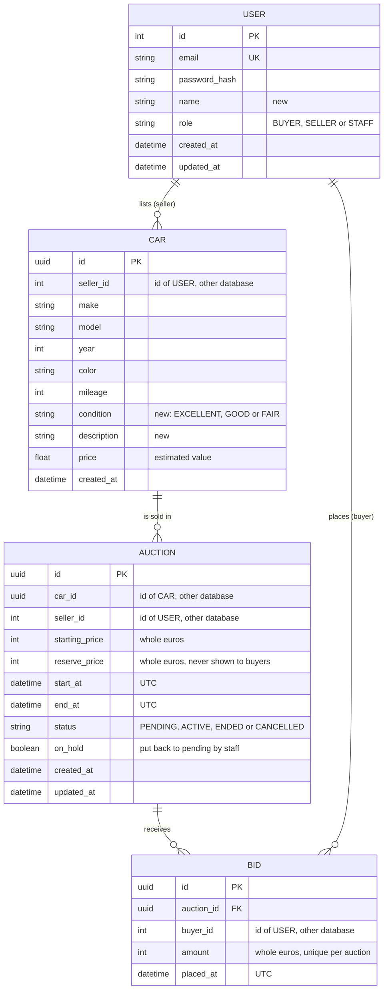

# Entity Relationship Diagram

The ERD of the VeloVault platform. Every service has its own database (CON-01), so the entities are split over 3 databases. Requirement IDs refer to [system-requirements.md](system-requirements.md).

| Database | Service | Entities |
|---|---|---|
| auth | auth service | USER |
| car | car service | CAR |
| auction | auction service (new) | AUCTION, BID |

## Relations

| Relation | Cardinality | Why |
|---|---|---|
| USER lists CAR | 1 seller has 0 or more cars | Diane sells more than one car (CAR-01) |
| CAR is sold in AUCTION | 1 car has 0 or more auctions | A car that didn't reach the reserve can be put in a new auction later. Only 1 can be pending or active at the same time. |
| AUCTION receives BID | 1 auction has 0 or more bids | Bid history (BID-05) |
| USER places BID | 1 buyer has 0 or more bids | Staff can see who bid (STF-07) |

## Links between databases

Only `BID.auction_id` is a real foreign key, because AUCTION and BID are in the same database. All the other links (`seller_id`, `car_id`, `buyer_id`) point to a row in another database. The database can't check those, so the service checks them:

- The auction service gets the user id and role from the gateway, which reads them from the login token (NFR-13). So it doesn't have to ask the auth service.
- When an auction is created, the auction service asks the car service if the car exists and belongs to the seller.
- The auction service never reads the car table directly. It only stores the car id.

## Choices

- **Amounts are whole euros (int).** Classic car bids are never in cents, and an int can't have rounding problems like a float.
- **Times are saved in UTC** and shown in Dutch time on the page (NFR-15).
- **The current highest bid is not saved in AUCTION.** It is the highest `amount` in BID for that auction. That way it can never be different from the bid history.
- **Roles change from USER/ADMIN to BUYER, SELLER and STAFF** (ACC-03). The first version of the auth service only had USER and ADMIN.
- **New fields in CAR:** `seller_id`, `condition` and `description` (CAR-01, CAR-02). `price` from the first version is used as the estimated value.
- **Photos (CAR-03) are not in this ERD.** They are not part of the 2 requirements I build.

## Changed while building

- **`on_hold` in AUCTION.** When staff put an active auction back to pending (STF-03), the scheduler would start it again straight away, because the start time has already passed. `on_hold` = true tells the scheduler to leave it alone until staff set a new start time. Buyers get "VeloVault has paused this auction".
- **Unique index on `(auction_id, amount)` in BID.** Two bids with the same amount on one auction are impossible in the database, also when they arrive at the same moment (BID-07). The bid itself is saved with one SQL statement that only inserts when the amount is still the highest, the index is the extra safety net.
- **`name` in USER** is filled in when registering, the role is chosen when registering (BUYER or SELLER), STAFF can't be chosen.
