# Hi-fi prototype

The high fidelity prototype for [place bid](use-case-place-bid.md) and [change auction status](use-case-change-auction-status.md). It follows the [wireflow](wireflow.md).

- Clickable prototype: [hi-fi-prototype/prototype.html](hi-fi-prototype/prototype.html). Open it in a browser and click through. Add `#b1` to `#b6` or `#s1` to `#s5` to the URL to open a screen directly.
- Screens as images: [hi-fi-prototype/](hi-fi-prototype/)

## Look and feel

Marcus wants the platform to feel "like walking into our showroom. Calm, a bit of polish, and the cars are the stars" (NFR-04).

| Choice | Why |
|---|---|
| Light grey-blue background, white cards, navy as the only colour for buttons and links | Calm and trustworthy, like a bank or a good showroom, not like a flea market site. One accent colour means Tom always knows what he can press. |
| Brass only as a small detail on the logo | Like the badge on a classic car: a bit of polish without stealing attention from the cars |
| One sans serif font, logo in capitals, titles in semi-bold | Clean and easy to read on a phone, also the numbers (current bid, time left) |
| Big photo on top of the auction page | The car is the main thing |
| No red, no capitals, no flashing banners, also not in the last hour | Marcus: no "ONLY 2 HOURS LEFT!!!" |
| Status always as a word with a dot, never only a colour | Tom is red-green colour-blind (BRW-05) |
| Amounts as € 18.500 with a dot | Dutch way of writing money |
| All times in Dutch time | NFR-15, a seller once thought his auction closed an hour early |

## Buyer screens (phone)

| Screen | | Heuristics (Nielsen) |
|---|---|---|
| **B1 Car list** | 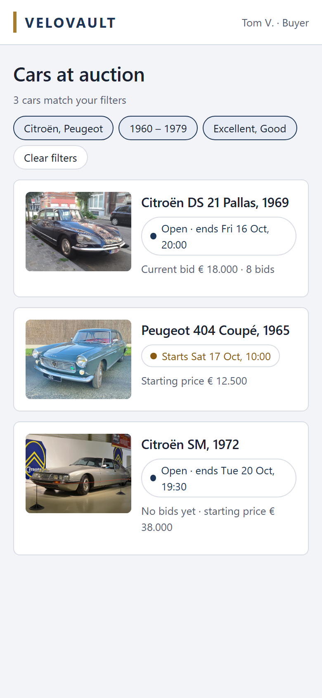 | **User control and freedom:** the filters are chips that can be cleared in one tap. **Recognition rather than recall:** the active filters stay visible, also after going back (BRW-03). |
| **B2 Auction page** | 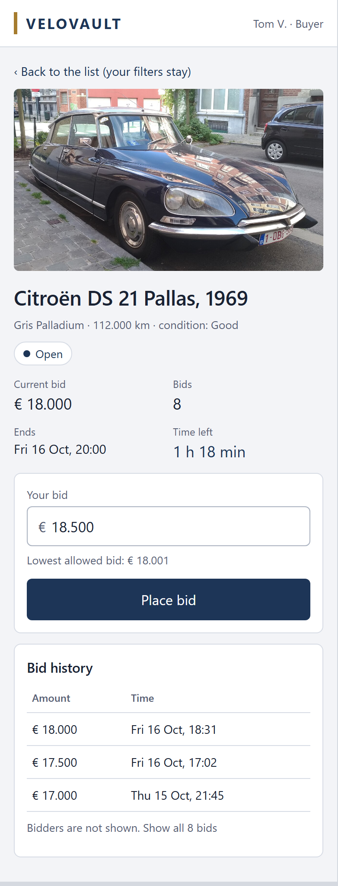 | **Visibility of system status:** status, current bid, number of bids, end time and time left are all at the top. **Error prevention:** the lowest allowed bid is shown under the field before Tom bids. **Match with the real world:** euros written the Dutch way, times in Dutch time. |
| **B3 Bid too low** | 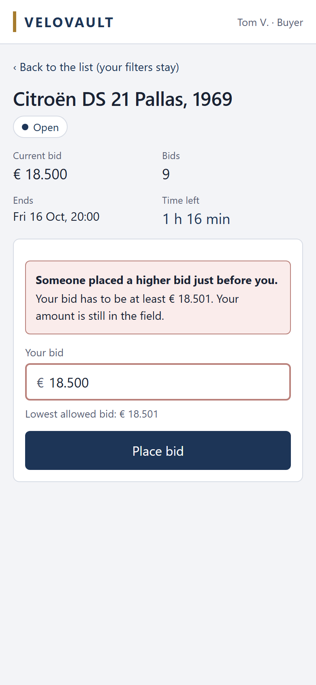 | **Help users recognize, diagnose and recover from errors:** the message says what happened and what the lowest bid is now. The amount stays in the field. No error code. |
| **B4 Bid placed** | 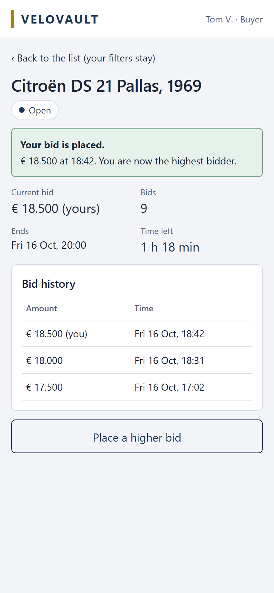 | **Visibility of system status:** clear confirmation with amount, time and "you are now the highest bidder" (BID-04). The bid also shows in the history as "(you)". |
| **B5 Auction closed** | 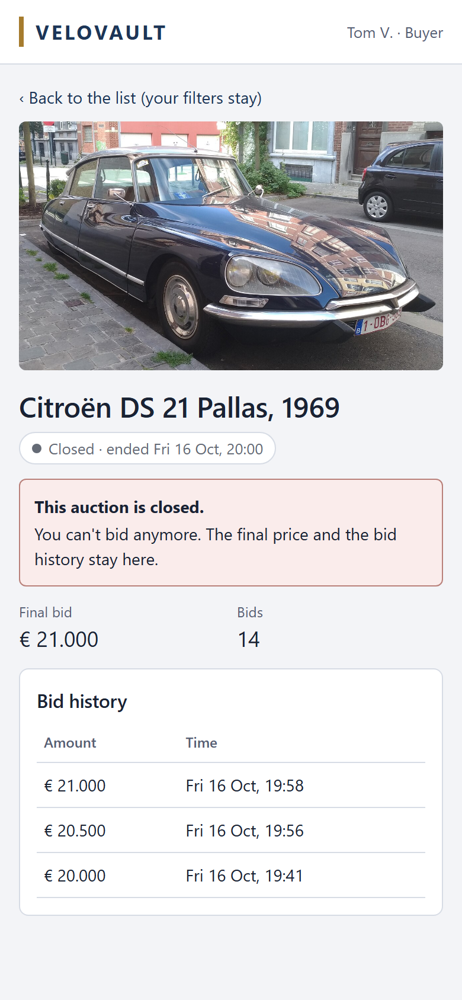 | **Error prevention:** the bid form is gone, so Tom can't try to bid. **Visibility of system status:** "Closed · ended Fri 16 Oct, 20:00" in words. The final price and the history stay (BID-06). |
| **B6 Log in again** | 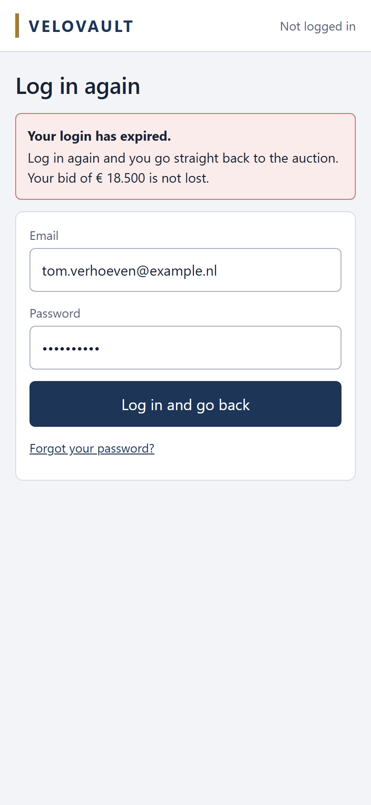 | **Help users recover from errors:** the message says the bid is not lost and that he goes straight back to the auction. |

## Staff screens (laptop)

| Screen | | Heuristics (Nielsen) |
|---|---|---|
| **S1 Search auctions** | 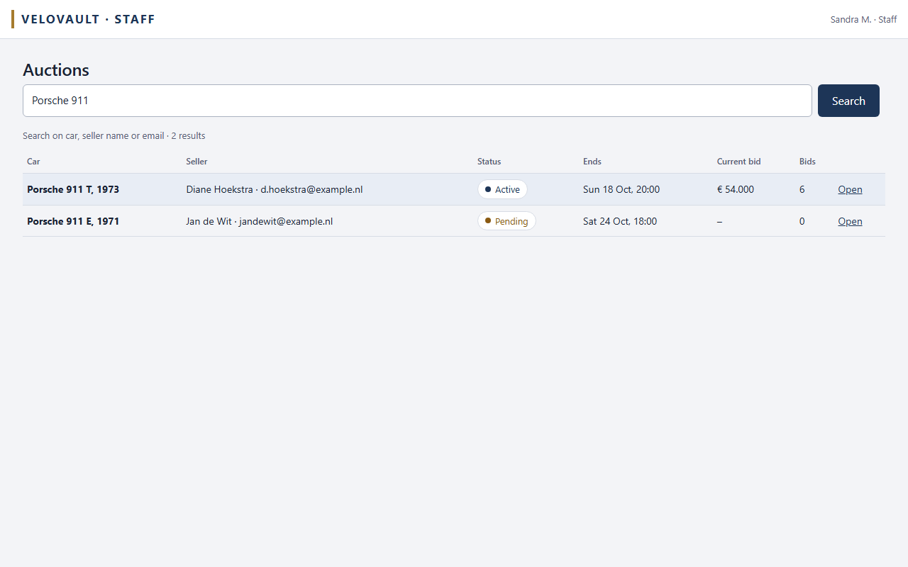 | **Flexibility and efficiency of use:** one search field for car, seller and email, because Sandra is often on the phone. **Match with the real world:** the results look like her spreadsheet. |
| **S2 Auction status** | 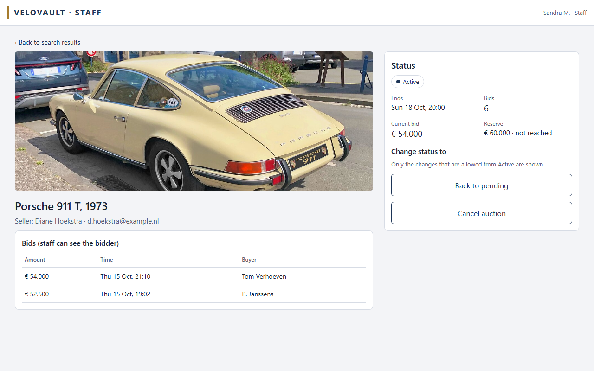 | **Error prevention:** only the allowed status changes are buttons. **Recognition rather than recall:** all information about the auction is on one screen. |
| **S3 Confirm** | 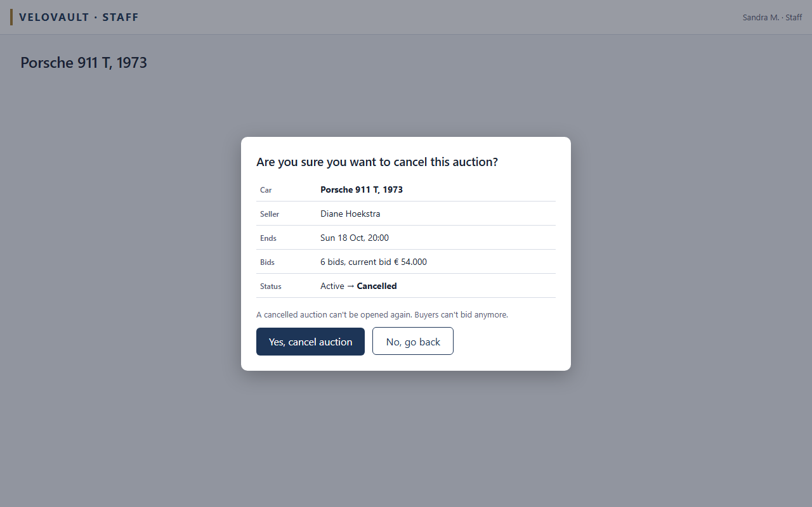 | **Error prevention:** "Are you sure?" with car, seller, end date and bids, so she can't cancel the wrong Porsche 911 (STF-04). **User control and freedom:** "No, go back" next to "Yes". |
| **S4 Status changed** | 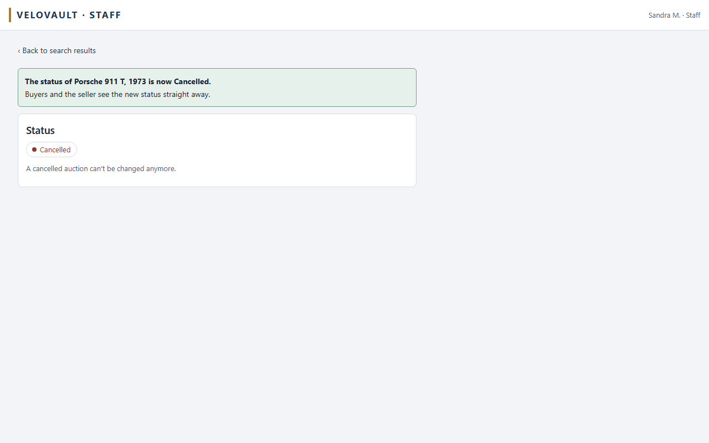 | **Visibility of system status:** says which car and what the new status is. |
| **S5 Not allowed** | 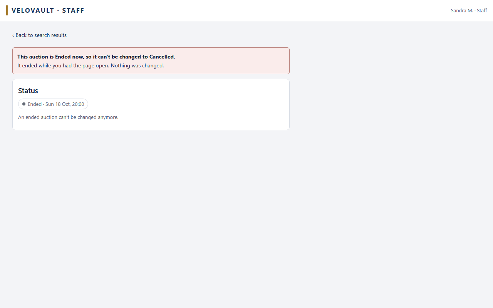 | **Help users recover from errors:** says why and that nothing was changed, in a sentence Sandra can read out to a seller on the phone. |

## Not in the prototype

- More than one photo per car, and uploading photos (CAR-03). That is not part of my 2 requirements, so each car has one demo photo.
- Screens for adding a car and creating an auction. They are not part of my 2 requirements.

## Photo credits

The demo photos come from Wikimedia Commons and are in [hi-fi-prototype/photos/](hi-fi-prototype/photos/). The app uses the same photos, see [code/frontend/static/cars/CREDITS.md](../code/frontend/static/cars/CREDITS.md).

| Photo | Author | Licence |
|---|---|---|
| [Citroën DS 21 Pallas](https://commons.wikimedia.org/wiki/File:Citroen_DS_21_Pallas_(45176422461).jpg) | Guillaume Vachey | CC0 |
| [Porsche 911 T](https://commons.wikimedia.org/wiki/File:Porsche-911-T-2.4-Classic-1973-LightIvory131-RAL1015-ARG-badgePCA-byRundvald.jpg) | Rundvald | CC BY-SA 4.0 |
| [Peugeot 404 Coupé](https://commons.wikimedia.org/wiki/File:Peugeot-404-coupe-Pininfarina-ecusson-Autocyclettes-byRundvald.jpg) | Rundvald | CC BY-SA 4.0 |
| [Alfa Romeo Giulia Sprint GT](https://commons.wikimedia.org/wiki/File:Alfa_Romeo_Giulia_Sprint_GT_(Bertone)-_P5200993-2.jpg) | Ermell | CC BY-SA 4.0 |
| [Citroën SM](https://commons.wikimedia.org/wiki/File:Le_Mans_-_Musee_24h_-_Citroen_SM_1.jpg) | Selbymay | CC BY-SA 3.0 |
| [Mercedes-Benz 280 SL](https://commons.wikimedia.org/wiki/File:Mercedes-Benz_W113_280_SL_2014-09-07_12-45-34.jpg) | Berthold Werner | CC BY-SA 3.0 |
