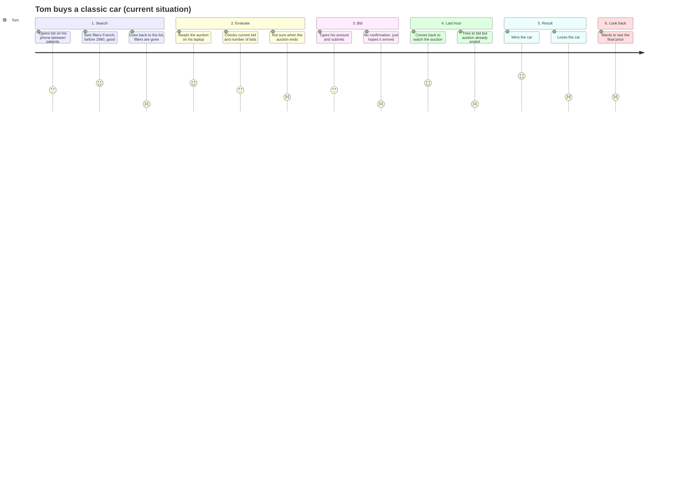

# Journey map: Tom Verhoeven, the buyer

This journey map follows [Tom](persona-buyer.md) from looking for a car to looking back at an auction that is finished. It is based on interview 3 (Tom) and the part of interview 1 where Marcus talks about the buyers. Requirement IDs refer to [system-requirements.md](system-requirements.md).

**Scenario:** Tom is looking for a Citroën or Peugeot from before 1980 in good condition. He finds one on VeloVault, follows the auction for a few days, bids in the last hour and either wins or loses.

**Goal:** Buy a car he wants for a fair price, without wasting time and without other collectors knowing what he is after.

## Emotion curve

Score 1 = very negative, 5 = very positive. This is how Tom feels with the current situation (newsletter and other auction sites), not with the new platform.

## Stages

| | 1. Search | 2. Evaluate | 3. Bid | 4. Last hour | 5. Result | 6. Look back |
|---|---|---|---|---|---|---|
| **What Tom does** | Opens the list on his phone in the evening or between patients. Filters on make, year and condition. Opens a car and goes back to the list. | Looks at the photos and the description. Opens the car again on his laptop to read everything properly. Checks the current bid, number of bids and the end time. | Types an amount and submits the bid. | Comes back to the auction in the last hour. Checks if he is still the highest bidder and bids again if needed. | Finds out if he won or lost. | Comes back later to an auction he lost and looks at the final price and the bid history. |
| **Touchpoint** | Car list (phone) | Auction page (phone and laptop) | Bid form | Auction page | Auction page, email from VeloVault | Auction page of an ended auction |
| **What Tom thinks** | "Only French cars, before 1980. I don't have time to scroll through fifty German cars." | "Eight bids and two hours left, that is a different story than no bids and five days left." | "I hope my bid is really higher than the one that is there." | "Am I still the highest? Is it still open?" | "Did I get it?" | "Was I being sensible or just stingy?" |
| **How Tom feels** | Hopeful, but in a hurry | Interested, calculating | Nervous | Adrenaline, heart rate goes up | Happy when he wins, it stings when he loses | Curious, a bit disappointed |
| **Pain points now** | Filters reset when he goes back to the list. | The end time is not clear. He once missed an auction because he thought it ended in the evening and it closed at noon. Open and closed shown in green and red, which he can't tell apart because he is colour-blind. | On another site a bid equal to the current bid was accepted. With the newsletter he mailed a bid and didn't know if it arrived. | The page did not refresh, he tried to bid on an ended auction and "nothing happened". | No clear moment where he hears the result. | Bid history and final price are gone after the auction ended. |
| **Opportunities** | Keep the filters when going back. Filter on make, year from/to and condition. List visible without logging in. | Show status in words ("Open", "Closed", "Starts Friday 14:00"). Show end date and time, and the time left in the last 24 hours. Show current bid and number of bids. | Check the amount and tell him the lowest allowed bid. Show a confirmation with amount, time and "you are the highest bidder". | Refuse bids on an auction that is not open and say why. Only one bid wins when two buyers bid at the same time. | Show the final status and price on the auction page. (A message when he is outbid is for later, BID-08.) | Keep the bid history and final price after the auction ended. No names in the history. |
| **Requirements** | BRW-01, BRW-02, BRW-03, NFR-01, NFR-06 | BRW-04, BRW-05, BRW-06, NFR-15 | BID-01, BID-02, BID-04, NFR-03 | BID-03, BID-07 | AUC-07, BID-06 | BID-05, BID-06, NFR-14 |

## Moments that matter

1. **Going back to the list (stage 1).** This is the lowest point at the start. If the filters are gone, Tom gives up between patients. BRW-03 fixes this.
2. **After submitting a bid (stage 3).** This is where the trust of VeloVault is won or lost. Tom wants to see straight away that it worked (BID-04). It also takes away half of Sandra's phone calls (interview 4).
3. **The last hour (stage 4).** Tom is most emotional here and has the least patience. The page has to say clearly if the auction is still open (BRW-05, BID-03), but stay calm, no "ONLY 2 HOURS LEFT!!!" (NFR-04).

## Link to the requirements I build

BID-01 (place a bid) covers stage 3 and the bidding part of stage 4. The requirements that go with it (BID-02, BID-03, BID-04, BID-05) take away the pain points in stages 3, 4 and 6. STF-03 (staff change the status) is not part of Tom's journey, but it makes sure the status he sees in stage 2 and 4 is correct.
