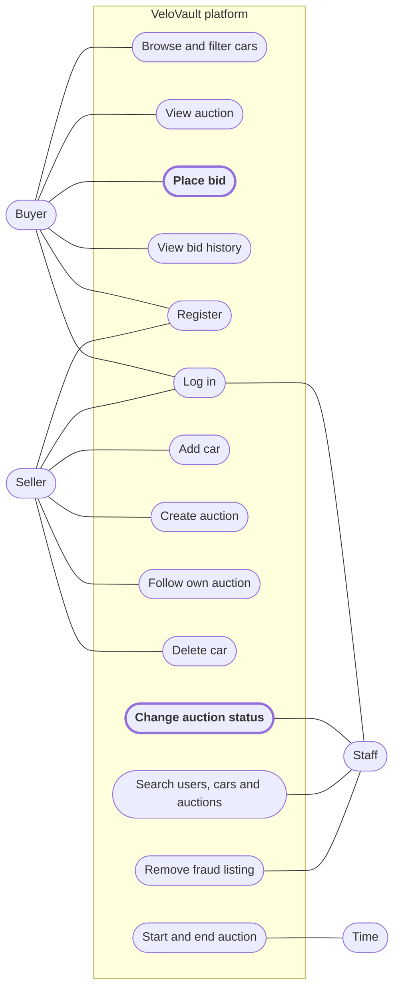
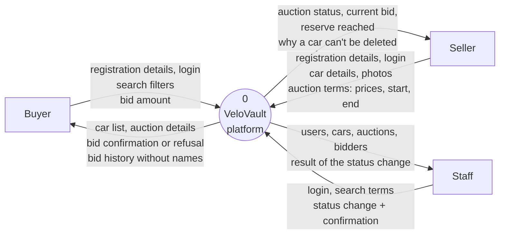

# System context diagrams

Two diagrams that show the boundary of the new VeloVault platform: a use case diagram and a level 0 DFD. Both are about the new platform, not the old process with email and the spreadsheet. Requirement IDs refer to [system-requirements.md](system-requirements.md).

## 1. Use case diagram

The actors stand outside the platform, the use cases are inside. The 2 use cases I build are in bold with a thick border.

| Use case | Actor | Requirements |
|---|---|---|
| Register | Buyer, seller | ACC-01, ACC-03 |
| Log in | Buyer, seller, staff | ACC-02, ACC-07 |
| Browse and filter cars | Buyer (also without an account) | BRW-01, BRW-02, BRW-03 |
| View auction | Buyer | BRW-04, BRW-05, BRW-06 |
| **Place bid** | Buyer | **BID-01**, BID-02, BID-03, BID-04, BID-07 |
| View bid history | Buyer | BID-05, BID-06 |
| Add car | Seller | CAR-01 to CAR-05 |
| Delete car | Seller | CAR-06, CAR-07 |
| Create auction | Seller | AUC-01 to AUC-04 |
| Follow own auction | Seller | AUC-08, AUC-09 |
| **Change auction status** | Staff | **STF-03**, STF-04, AUC-05 |
| Search users, cars and auctions | Staff | STF-01, STF-02, STF-05 |
| Remove fraud listing | Staff | STF-06 |
| Start and end auction | Time | AUC-06, AUC-07 |

**Why "Time" is an actor:** nobody presses a button to start or end an auction. It happens by itself at the start and end time, also at 2 at night (Marcus, Erik). So the trigger comes from outside the system, and that makes time an actor.

**Why staff don't bid or sell:** Marcus wants staff to oversee and step in, not to take part in auctions.

## 2. Level 0 DFD (context diagram)

The whole platform is one process. Around it are the external entities and the data that goes in and out. The databases are inside the platform, so they are not on this level.

| Data flow | From | To |
|---|---|---|
| Registration details, login | Buyer, seller, staff | Platform |
| Search filters (make, year, condition) | Buyer | Platform |
| Bid amount | Buyer | Platform |
| Car list, auction details | Platform | Buyer |
| Bid confirmation or refusal with the reason | Platform | Buyer |
| Bid history (amount and time, no names) | Platform | Buyer |
| Car details, photos | Seller | Platform |
| Auction terms (starting price, reserve price, start, end) | Seller | Platform |
| Auction status, current bid, number of bids, reserve reached | Platform | Seller |
| Message why a car can't be deleted | Platform | Seller |
| Search terms, status change and confirmation | Staff | Platform |
| Users, cars, auctions and who placed bids | Platform | Staff |
| Result of the status change | Platform | Staff |

**Why "Time" is not in the DFD:** a DFD shows data. Time doesn't send data to the platform, it only triggers something. So it is an actor in the use case diagram but not an entity here.

**Reserve price:** it goes from the seller into the platform, but never out to the buyer (AUC-04). The seller only gets back whether it is reached.
