# Wireflow

Wireflow for my 2 use cases: [place bid](use-case-place-bid.md) (buyer, on a phone) and [change auction status](use-case-change-auction-status.md) (staff, on a laptop). The wireframes are in [wireflow/](wireflow/), the same screens in the real look are in the [hi-fi prototype](hi-fi-prototype.md).

## Buyer: place bid

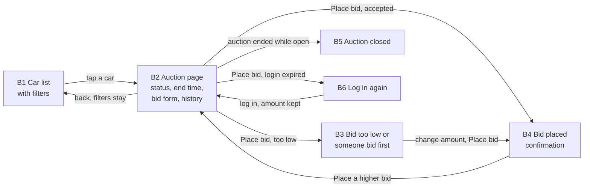

| Screen | Wireframe | What is on it | Use case step |
|---|---|---|---|
| B1 Car list | 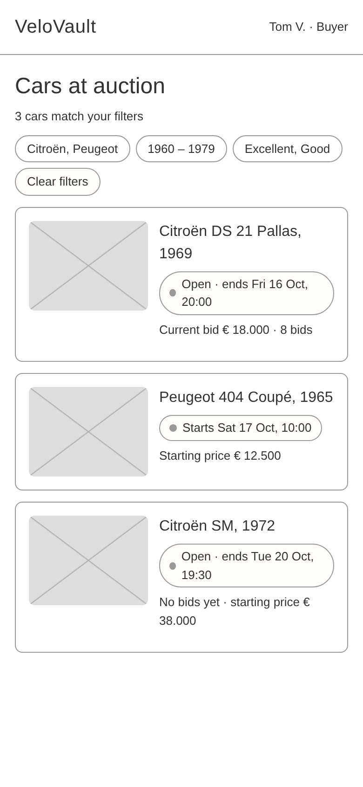 | Filters for make, year and condition as chips that stay on. Every car with status in words and end time. | before step 1 |
| B2 Auction page | 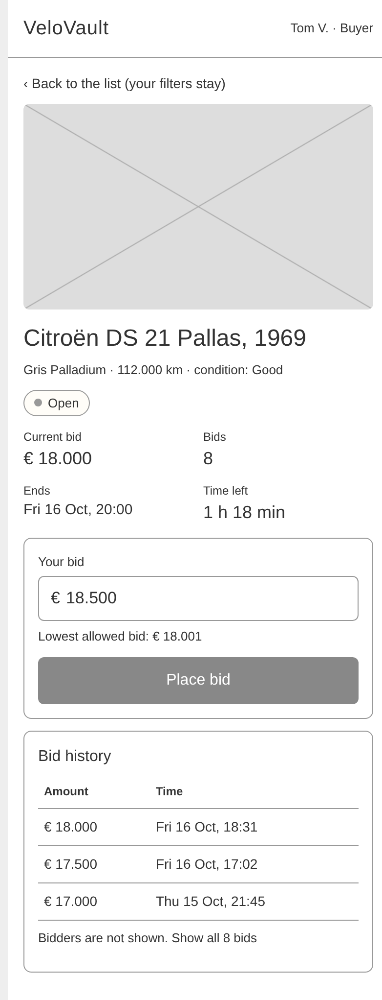 | Photo, car details, status "Open", current bid, number of bids, end time and time left. Bid form with the lowest allowed bid. Bid history without names. | 1 |
| B3 Bid too low | 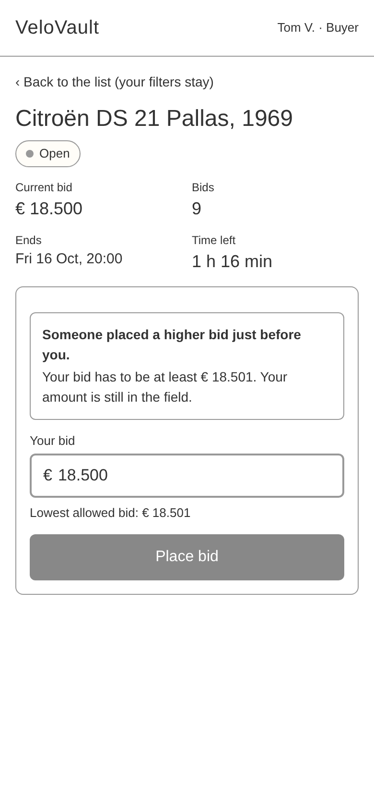 | Message above the field, the amount stays in the field, new lowest allowed bid. | 4a, 5a |
| B4 Bid placed | 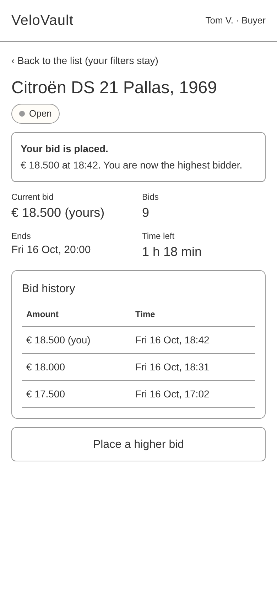 | Confirmation with amount, time and "you are now the highest bidder". Updated current bid and history. | 6, 7 |
| B5 Auction closed | 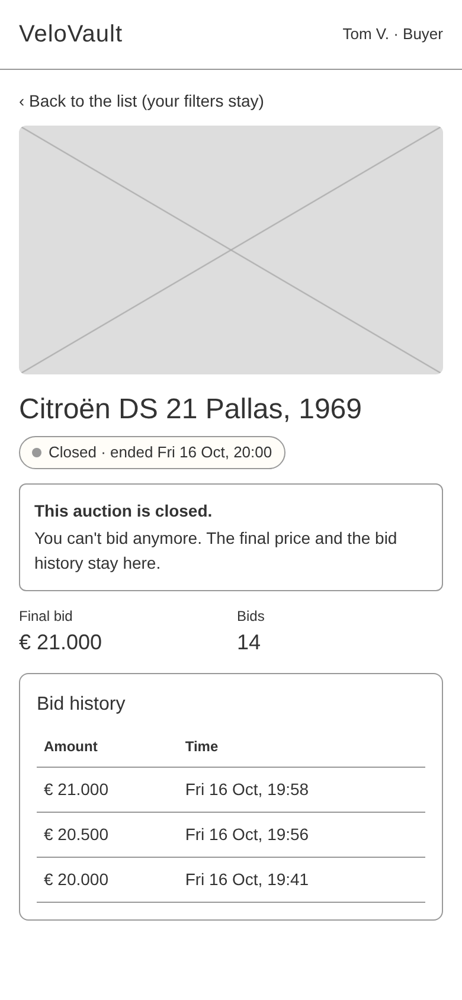 | Status "Closed" in words, no bid form, message why, final price and history stay. | 3b |
| B6 Log in again | 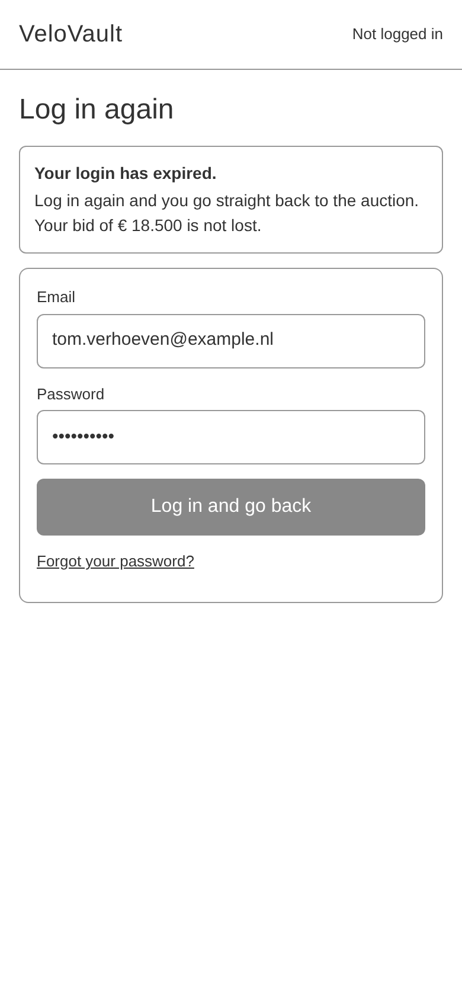 | Message that the login expired and that the bid is not lost. After logging in back to the auction. | 2a |

## Staff: change auction status

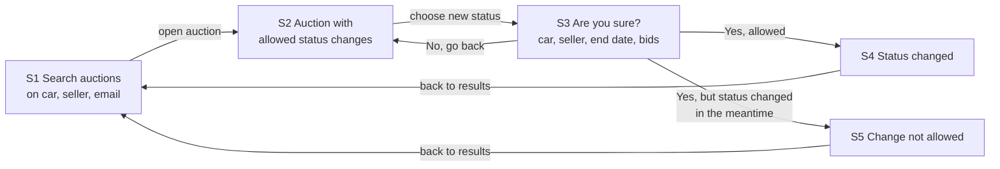

| Screen | Wireframe | What is on it | Use case step |
|---|---|---|---|
| S1 Search auctions | 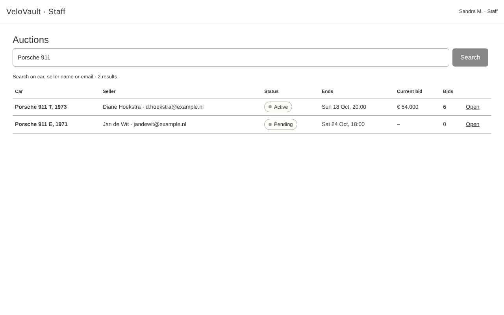 | One search field for car, seller name or email. Table like a spreadsheet with car, seller, status, end, current bid and bids. | 1 |
| S2 Auction status | 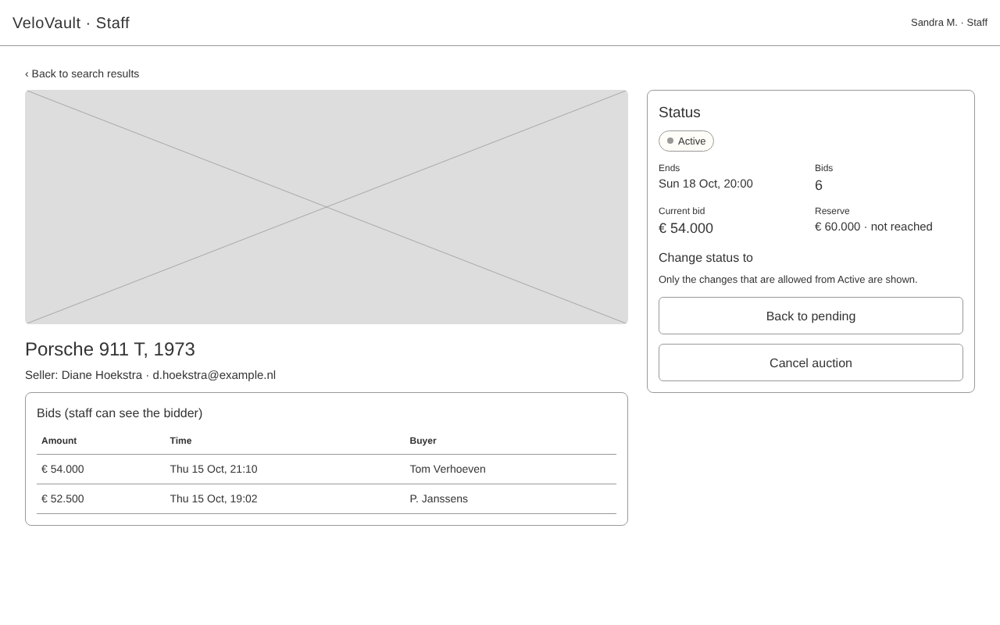 | Car, seller, bids with the buyer names (only staff), reserve. Only the allowed status changes as buttons. | 2, 3, 4 |
| S3 Confirm | 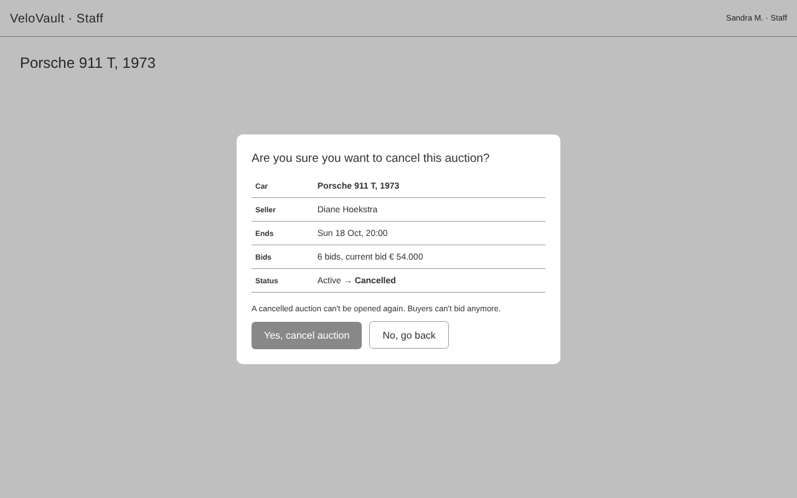 | Dialog with car, seller, end date, bids and old and new status. "Yes" and "No, go back". | 5, 6, 6a |
| S4 Status changed | 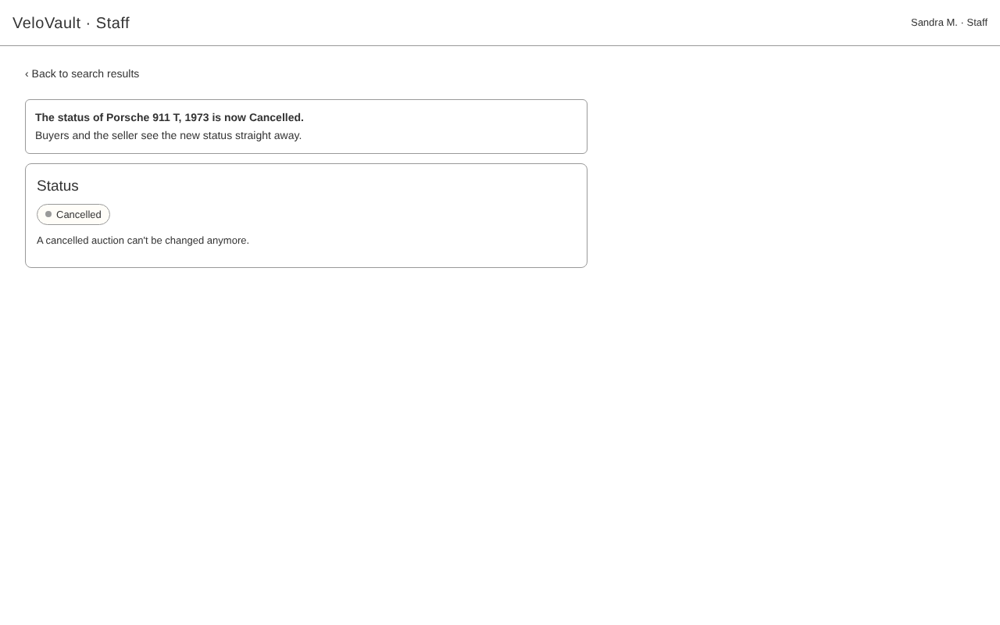 | Message with the car and the new status. | 10 |
| S5 Not allowed | 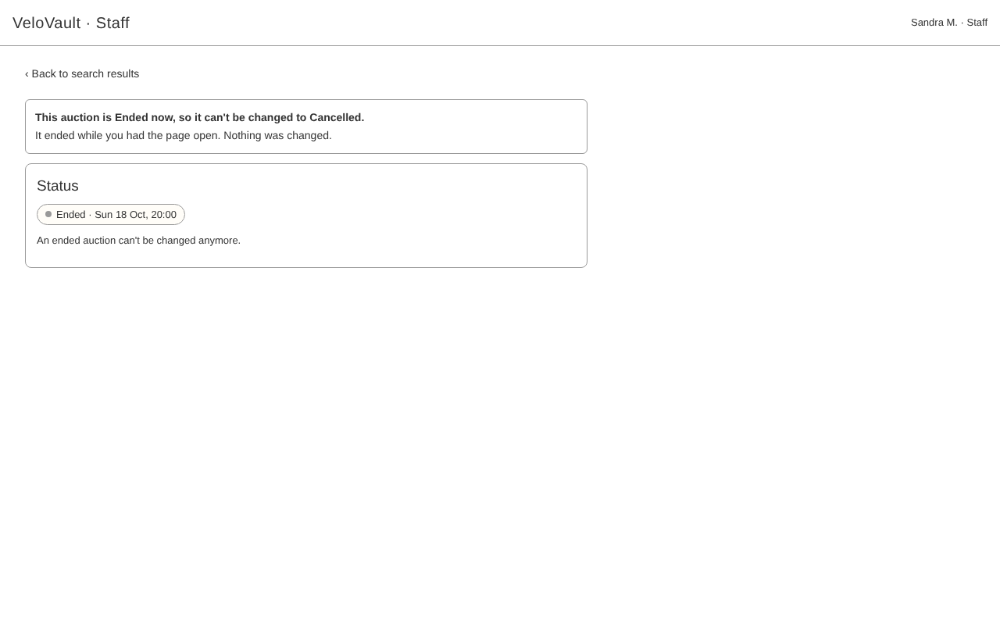 | Message why, the current status, and that nothing was changed. | 8a |

## Choices

- **The buyer flow is drawn for a phone** (390 px) because Tom bids on his phone. **The staff flow is for a laptop** because Sandra works at her desk with two screens.
- **Errors bring you back to where you were** (B3, B6). Tom doesn't have to start again.
- **S2 only shows the allowed changes.** That way Sandra can't even choose a change that is not allowed. S5 is still needed because the auction can end while she has the page open.
- **"Service not available" (5b, 9a)** is not a separate screen. It is the same message box as B3 and S5 with a different text.
